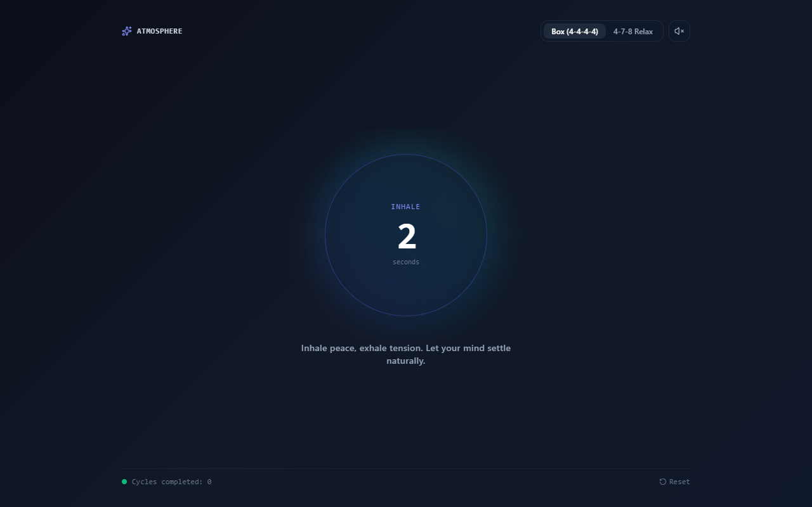
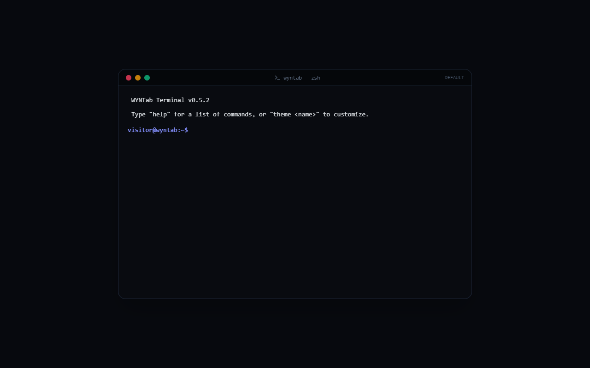
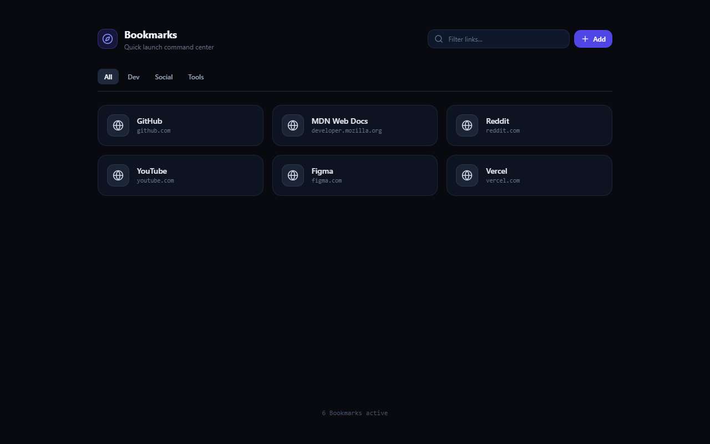
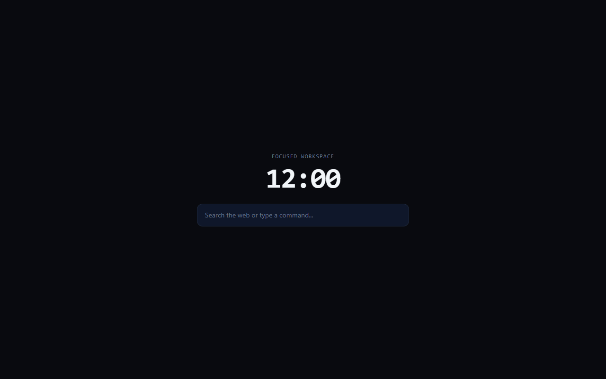
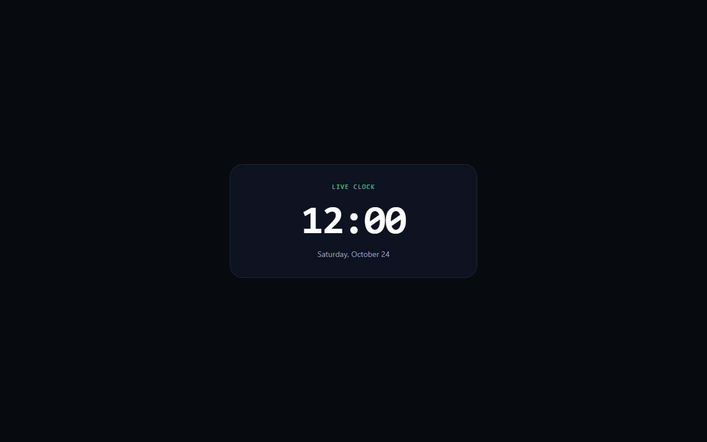

<p align="center">
  
</p>

<h1 align="center">WYNTab</h1>

<p align="center">
  <strong>Write Your NewTab</strong> — An open-source browser extension to build, edit, and run custom HTML, CSS, and React templates as your new tab page.
</p>

<p align="center">
  <a href="https://github.com/getwyntab/wyntab/releases/latest"></a>
  <a href="https://chromewebstore.google.com/detail/wyntab/hbfabaimiglbfjhcppfedgjkpfgabiff"></a>
  <a href="LICENSE"></a>
</p>

## Overview

WYNTab replaces default new tab clutter with an isolated sandbox environment where your own code runs instantly. Build dashboards, clocks, note-taking pads, or full web apps directly in the browser with an integrated CodeMirror editor, or upload static HTML bundles with zero external build configuration.

## Installation

### Chrome Web Store

Install directly from the [Chrome Web Store](https://chromewebstore.google.com/detail/wyntab/hbfabaimiglbfjhcppfedgjkpfgabiff) *(compatible with Chrome, Brave, Edge, Opera, and Vivaldi)*.

### Manual Install

1. Download `wyntab-*-chrome.zip` from the [Latest Release](https://github.com/getwyntab/wyntab/releases/latest).
2. Unzip the downloaded file.
3. Open `chrome://extensions` in your Chromium browser and enable **Developer mode** (top-right toggle).
4. Click **Load unpacked** and select the unzipped directory.

## Features

* **In-Browser Code Editor:** Full-canvas CodeMirror 6 editor with syntax highlighting, line numbers, and live split-screen preview.
* **On-the-Fly React & JSX:** Transpiles JSX in the browser via Sucrase without needing Node.js or bundlers.
* **Isolated Sandbox Execution:** Templates run inside a dedicated `sandbox.html` runtime via `postMessage`, complying with strict Manifest V3 Content Security Policies.
* **External Module Imports:** Load modern ES modules directly from `https://esm.sh` or style with Tailwind CSS within your templates.
* **Scoped Storage Bridge:** Access asynchronous persistent storage with `window.wyntab` (`get`, `set`, `remove`) scoped per template.
* **Data Portability:** Export and import your custom templates and configurations via JSON backups.
* **Local & Private:** No analytics, external tracking, or account requirements. All data stays in your browser's local storage.
* **Zero-Latency Startup:** Background pre-render pipeline prevents blank or white flashes on new tab initialization.

## Built-in Templates

| Name | Preview |
| :--- | :---: |
| **Atmosphere** |  |
| **Terminal** |  |
| **Links** |  |
| **Minimal** |  |
| **Time** |  |

## Creating Custom Templates

You can build templates manually in the WYNTab editor, upload single `.html` files, or generate complete custom new tab pages using AI models (ChatGPT, Claude, Gemini).

### Generating Templates with AI

Copy and paste the following prompt into your preferred AI model along with your desired features:

```text
Create a single-file HTML new tab page for the WYNTab browser extension.

Technical Specifications:
1. Deliver a single, complete, self-contained HTML file (all CSS in <style> and all JS in <script> or <script type="module">).
2. Layout must fill the full viewport (100vw by 100vh) with zero margin and zero scrollbar overflow:
   html, body { width: 100vw; height: 100vh; margin: 0; padding: 0; overflow: hidden; }
3. Theme: Utilitarian dark-mode first (#121212 / #1E1E1E surfaces with high-contrast readable typography).
4. Styling: You may include Tailwind CSS directly via:
   <script src="https://cdn.tailwindcss.com"></script>
5. Libraries: You may import external ES modules directly from https://esm.sh/ (e.g. canvas-confetti, lucide, chart.js).
6. Data Persistence: For any user data (notes, bookmarks, settings, todos), use WYNTab's asynchronous storage bridge instead of localStorage:
   - Save: await window.wyntab.set('key', value)
   - Read: const val = await window.wyntab.get('key')
   - Delete: await window.wyntab.remove('key')

Feature Requirements:
[Describe your desired new tab experience here — e.g., "A minimalist Pomodoro timer with daily top-3 task checklist and keyboard shortcuts."]
```

Once generated, click **New Template** (`+`) in the WYNTab Dashboard, paste the code, and click **Save Changes**.

## Template API

Templates running in WYNTab communicate with extension storage through a scoped bridge on `window.wyntab`:

```javascript
// Store a value scoped to the current template
await window.wyntab.set('notes', 'Review pull requests before release');

// Retrieve a stored value
const notes = await window.wyntab.get('notes');

// Delete a stored key
await window.wyntab.remove('notes');
```

### Loading External Modules

Templates can import ES modules from trusted CDNs directly:

```html
<script type="module">
  import confetti from 'https://esm.sh/canvas-confetti';
  confetti();
</script>
```

## Development

### Prerequisites

* Node.js 20 or 22 LTS
* npm

### Setup

```bash
# Clone the repository
git clone https://github.com/getwyntab/wyntab.git
cd wyntab

# Install dependencies
npm install

# Start development runner (Chrome MV3)
npm run dev
```

### Testing and Validation

```bash
# Run unit and component test suite
npm test

# Strict TypeScript type check
npm run compile

# Design token audit against DESIGN.md
npm run design:lint
```

### Building Packages

```bash
# Build production extension package
npm run zip    # Output: .output/wyntab-*-chrome.zip
```

## Architecture & Security

* **Sandboxed Execution:** Templates run exclusively inside an unprivileged `sandbox.html` iframe with `sandbox="allow-scripts allow-forms allow-popups allow-modals"`.
* **API Isolation:** Sandbox iframe has zero access to privileged `chrome.*` extension APIs (`chrome.cookies`, `chrome.tabs`, `chrome.webRequest`).
* **Local Sanitization:** Uploaded templates pass through a strict DOMParser sanitization engine before saving to local storage. Zero telemetry or external network calls.

## Contributing

Contributions, bug reports, and feature requests are welcome via [Issues](https://github.com/getwyntab/wyntab/issues).
Architecture and engineering standards are documented in [.agents/AGENTS.md](.agents/AGENTS.md).

## License

Copyright (c) 2026 WYNTab Authors.

Licensed under the [Apache License, Version 2.0](LICENSE).
